  

# 📱 Awesome Mobile LLM Running & Android On-Device AI ⚡

  
  
  
  
  
  

---

## 🌟 Top Mobile LLM Running & Android On-Device AI Ecosystem

> 🚀 **The definitive, curated directory of edge AI platforms, mobile inference runtimes, and local LLM tooling.**  
> Focused on on-device Android & iOS LLM runners, NPU/GPU hardware acceleration (Qualcomm Hexagon QNN, Arm Mali Vulkan, OpenCL, Apple Metal), Termux local harnesses, offline SLMs/VLMs, and privacy-preserving edge architectures.

📅 **Last updated: November 2026**

---

### 🔍 Overview & SEO Highlights
Running quantized Large Language Models (`GGUF`, `MLC`, `LiteRT`, `ExecuTorch`, `MNN`) directly on mobile hardware enables zero-latency inference, 100% offline privacy, zero server egress costs, and seamless edge intelligence. Whether you are executing DeepSeek, Llama 3, Qwen 2.5, Gemma 3n, or SmolLM on a smartphone via Snapdragon NPU, Mali GPU shaders, or inside a native Android Termux Linux environment, this repository curates the industry's top commercial SaaS toolchains and battle-tested open-source repositories.

---

## 📑 Table of Contents
- [📊 Sector Overview & Market Dynamics](#-sector-overview--market-dynamics)
- [🏢 SaaS & Hosted Commercial Platforms](#-saas--hosted-commercial-platforms)
- [💻 Open-Source GitHub Projects](#-open-source-github-projects)
- [📦 Additional Strong Open-Source Options & Edge Models](#-additional-strong-open-source-options--edge-models)
- [🛠️ Recommended Offline Mobile AI Architecture Stack](#-recommended-offline-mobile-ai-architecture-stack)
- [🤝 How to Contribute](#-how-to-contribute)
- [💖 Support & Sponsorship](#-support--sponsorship)
- [📈 Star History](#-star-history)
- [⚠️ Disclaimer](#️-disclaimer)

---

## 📊 Sector Overview & Market Dynamics

The edge and on-device AI sector is experiencing explosive growth, expanding from an estimated global market size of **$18.5 Billion in 2024** to a projected **$60+ Billion by 2030** (growing at a 25–28% CAGR). The market structure is **moderately fragmented across software and application layers**, where specialized app frontends, Termux harnesses, and modular inference engines compete fiercely. However, it remains **highly concentrated at the silicon and platform OS layer**, where a small oligopoly of silicon designers (Qualcomm, Apple, MediaTek) and OS platform gatekeepers (Google Android, Apple iOS) hold near-monopolistic control over mobile NPU compilers, driver firmware, and system-level API access.

---

## 🏢 SaaS & Hosted Commercial Platforms

Below is an exhaustive breakdown of commercial and SaaS developer platforms facilitating mobile and edge AI deployment. Sorted in descending order by **Company Size / Valuation / Market Cap**.

| 🏷️ Platform | 🏢 Company Size (Revenue / Valuation) | 💰 Pricing (Starting Tier) | 🎁 Free Tier Limits | 📝 Description |
| :--- | :--- | :--- | :--- | :--- |
| **[Apple Foundation Models & Private Cloud Compute](https://apple.com)** | **$3.45 Trillion Market Cap** ($391B FY24 Rev) | **$99/year** (Apple Developer Program fee to deploy custom models & PCC credentials) | **Free local execution on-device** for all Apple hardware owners; Xcode & CoreML profiling tools included for free. | Apple's hybrid on-device CoreML/MLX and hardware-encrypted Private Cloud Compute architecture powering local intelligence on iPhone and iPad. |
| **[Google AI Edge (Gemini Nano & MediaPipe)](https://google.dev)** | **$2.15 Trillion Market Cap** ($307B FY24 Rev) | **$0.00** for on-device AICore; Cloud Gemini APIs start at **$0.075 per 1M input tokens** (Pay-as-you-go). | **Free forever on-device** via system Android AICore on supported Pixel/Samsung devices; MediaPipe model makers are 100% free with unlimited local inference. | Google's developer ecosystem for deploying Gemini Nano on-device via Android AICore and compiling custom models with LiteRT across mobile NPUs. |
| **[Qualcomm AI Hub](https://qualcomm.com)** | **$185 Billion Market Cap** ($38.9B FY24 Rev) | **$0.00 standard access**; Enterprise custom silicon quantization starting at **$5,000/month**. | **Free forever community account** with 10 on-cloud hosted physical device benchmark runs per day across Snapdragon 8 Gen 2/3/4 test racks. | Cloud model optimization, quantization, and real-device benchmarking platform compiling LLMs and VLMs directly into Qualcomm QNN binaries for Hexagon NPUs. |
| **[RunAnywhere / Together AI](https://together.ai)** | **$3.3 Billion Valuation** ($50M+ ARR) | Pay-as-you-go starting at **$0.10 per 1M tokens** for hosted Llama-3-8B fallback API. | **$5.00 one-time free credit** valid for 90 days upon registration; zero ongoing free tokens. | Cloud-to-edge model distillation, quantization, and fallback inference platform bridging local mobile SLMs with cloud frontier models when offline context limits are exceeded. |
| **[LM Studio](https://lmstudio.ai)** | **~$50 Million Valuation** ($5M+ ARR) | Commercial team licenses start at **$20/user/month** (Annual billing). | **Free forever for personal, offline non-commercial use** on unlimited local machines and mobile local network servers with no time limit. | Commercial-friendly local LLM runner and server platform providing curated GGUF/MLX model discovery and local network headless REST API serving for mobile apps. |
| **[Nexa AI](https://nexa.ai)** | **~$25 Million Valuation** ($2M ARR) | Pro Developer tier starts at **$19/month** for full cross-platform on-device compilation and model encryption. | **Free Community Plan** with unlimited local SDK compilation for open-weight models (Octopus) on Android/iOS/PC; 100 cloud build conversions/month. | Edge AI developer platform offering optimized small language models (`Octopus`) and cross-platform NPU/GPU mobile inference SDKs. |
| **[Layla AI](https://layla-network.ai)** | **~$5 Million Valuation** ($1.2M ARR) | **$19.99 one-time purchase** on Google Play Store & iOS App Store. | **No free tier**; 48-hour standard Google Play refund window serves as trial evaluation. | Commercial mobile-first local AI assistant app running quantized LLMs, vision models, and voice synthesis directly on Android and iOS devices. |
| **[Private LLM](https://privatellm.app)** | **~$2 Million Valuation** ($500K ARR) | **$9.99 one-time purchase** on iOS & macOS App Store. | **No free tier**; Apple 14-day standard App Store refund policy applies. | Commercial offline mobile AI application running quantized GGUF models natively on Apple Neural Engine and Metal GPUs with zero cloud telemetry. |

---

## 💻 Open-Source GitHub Projects

Curated list of open-source mobile LLM runtimes, Termux server harnesses, and on-device frontends. Sorted in descending order by **GitHub Star Counts** ⭐.

| 📦 Repository | ⭐ GitHub Stars | 🎯 Category / Primary Focus | 🛠️ Supported Hardware & Ecosystem |
| :--- | :--- | :--- | :--- |
| **[ollama/ollama](https://github.com/ollama/ollama)** |  | Local LLM Runner & Server | CPU, ARM64, Termux PRoot, LAN companion serving |
| **[ggerganov/llama.cpp](https://github.com/ggerganov/llama.cpp)** |  | Foundational C/C++ Inference Runtime | Android NDK, ARM NEON, Vulkan GPU, Qualcomm KleidiAI, OpenCL |
| **[vllm-project/vllm](https://github.com/vllm-project/vllm)** |  | High-Throughput Edge Backend | Distributed LAN serving, WireGuard remote mobile client link |
| **[termux/termux-app](https://github.com/termux/termux-app)** |  | Android Terminal & Linux Harness | Native Android ARM64, Clang, CMake, Python 3, CLI LLM tools |
| **[ggerganov/whisper.cpp](https://github.com/ggerganov/whisper.cpp)** |  | Speech Recognition (ASR) Engine | Android NDK, ARM NEON, OpenCL, zero-latency local voice input |
| **[mudler/LocalAI](https://github.com/mudler/LocalAI)** |  | OpenAI-Compatible Local Engine | ARM64 Linux, Termux, audio transcription, image gen, multi-backend |
| **[exo-explore/exo](https://github.com/exo-explore/exo)** |  | Distributed P2P Device Clustering | Android phones, iPads, laptops, LAN sharded tensor parallelism |
| **[janhq/jan](https://github.com/janhq/jan)** |  | 100% Offline AI Assistant & Server | Desktop/LAN API backend built on llama.cpp with mobile remote link |
| **[sgl-project/sglang](https://github.com/sgl-project/sglang)** |  | Structured Generation & Serving | High-speed RadixAttention backend for mobile agentic clients |
| **[ml-explore/mlx](https://github.com/ml-explore/mlx)** |  | Apple Silicon Unified Memory Array | Metal GPU, Apple Neural Engine, iOS/macOS native execution |
| **[Tencent/ncnn](https://github.com/Tencent/ncnn)** |  | Mobile-First Neural Network Engine | Ultra-optimized ARM NEON assembly, Vulkan compute on Android/iOS |
| **[mlc-ai/mlc-llm](https://github.com/mlc-ai/mlc-llm)** |  | Universal Compilation Engine | Android OpenCL, Adreno/Mali Vulkan, iOS Metal, WebGPU |
| **[alibaba/MNN](https://github.com/alibaba/MNN)** |  | Mobile Neural Network (MNN-LLM) | Android CPU, OpenCL, Vulkan, NPU backends, ultra-lightweight |
| **[k2-fsa/sherpa-onnx](https://github.com/k2-fsa/sherpa-onnx)** |  | Offline Speech STT / TTS Runtime | Android NDK, iOS, embedded devices, offline bidirectional voice |
| **[OpenBMB/MiniCPM](https://github.com/OpenBMB/MiniCPM)** |  | Edge-Tuned Multimodal SLM | On-device VLM & LLM with native Android APK inference demos |
| **[a-ghorbani/pocketpal-ai](https://github.com/a-ghorbani/pocketpal-ai)** |  | Native React Native Mobile App | Android/iOS GGUF inference, in-app model downloader, benchmarking |
| **[NexaAI/nexa-sdk](https://github.com/NexaAI/nexa-sdk)** |  | On-Device Cross-Platform SDK | Android NPU, Apple Silicon, ONNX, GGUF, Octopus function-calling |
| **[InternLM/lmdeploy](https://github.com/InternLM/lmdeploy)** |  | Compression & Deployment Engine | 4-bit AWQ/KV cache quantization for edge & server endpoints |
| **[google/gemma.cpp](https://github.com/google/gemma.cpp)** |  | Standalone C++ Gemma Runtime | Google Highway SIMD, portable edge CPU inference |
| **[pytorch/executorch](https://github.com/pytorch/executorch)** |  | PyTorch Official Edge Runtime | Qualcomm Hexagon QNN, MediaTek Neuropilot, CoreML, Vulkan |
| **[huggingface/smollm](https://github.com/huggingface/smollm)** |  | Ultra-Lightweight Mobile SLMs | 135M, 360M, 1.7B parameters designed specifically for phone memory |
| **[google-ai-edge/LiteRT](https://github.com/google-ai-edge/LiteRT)** |  | Google AI Edge (formerly TF Lite) | Android GPU delegate, MediaPipe LLM Inference API, mobile NPU |
| **[Vali-98/ChatterUI](https://github.com/Vali-98/ChatterUI)** |  | Mobile LLM Frontend | Android local GGUF inference (`llama.rn`), RAG document chat, cards |
| **[Mobile-Artificial-Intelligence/maid](https://github.com/Mobile-Artificial-Intelligence/maid)** |  | Flutter Local LLM Frontend | Multi-platform Flutter app running llama.cpp locally on Android |
| **[mybigday/llama.rn](https://github.com/mybigday/llama.rn)** |  | React Native Bindings for llama.cpp | Cross-platform mobile JSI bindings for high-performance mobile UI |
| **[Soodok/Deepseek-Harness-Local-Android](https://github.com/Soodok/Deepseek-Harness-Local-Android)** |  | Android DeepSeek Setup Toolkit | Automated Termux script & local execution harness for Android |

---

## 📦 Additional Strong Open-Source Options & Edge Models

- **[Cactus](https://github.com)**: Lightweight C++ runtime bridging cross-platform mobile apps directly to `llama.cpp` kernels.
- **[SmolVLM / Qwen2.5-VL / Gemma 3n / Phi-4-mini](https://huggingface.co)**: Leading open-weights `1B–4B` parameter multimodal and reasoning models designed to fit comfortably in `6 GB–12 GB` mobile RAM.
- **[PowerInfer](https://github.com)** & **[FastLLM](https://github.com)**: High-speed sparse-activation and memory-bandwidth-optimized inference engines for consumer and mobile devices.
- **Offline Mobile RAG Stacks**: Emerging lightweight vector extensions like `sqlite-vec` coupled with local embedding models (e.g., `bge-micro`, `nomic-embed-text`) running natively on mobile storage.

---

## 🛠️ Recommended Offline Mobile AI Architecture Stack

To build a **100% offline, privacy-first mobile AI assistant**, the community standard architecture combines:
1. **On-Device Inference Runtime**: `llama.cpp` or `ExecuTorch` (compiled with Qualcomm QNN or Vulkan delegates).
2. **Mobile Frontend / UI**: `PocketPal AI` or `ChatterUI` (for intuitive model switching, prompt templates, and streaming tokens).
3. **Voice Input/Output (ASR & TTS)**: `Sherpa-ONNX` or `whisper.cpp` (for offline, latency-free voice transcription and speech synthesis).
4. **Local Android Environment**: `Termux` with `Soodok/Deepseek-Harness-Local-Android` (for CLI debugging, model quantization, and local headless REST servers).

---

## 🤝 How to Contribute

We welcome contributions from the community! To submit additions or corrections:
1. 🍴 **Fork** this repository.
2. 📝 **Add or update** entries in `README.md` (ensure SaaS and open-source formats and table columns are preserved).
3. 💬 **Keep descriptions** concise, factual, and backed by official links and pricing details.
4. 🚀 **Submit a Pull Request** with a descriptive summary of your changes.

---

## 💖 Support & Sponsorship

If you find this curated ecosystem helpful for your mobile development, research, or edge AI experiments, please consider supporting the project:

- ⭐ **Star this repository** to help others discover it!
- 🍴 **Fork and share** with fellow edge developers and Android tinkerers.
- ☕ **Buy a coffee & sponsor**: You can sponsor future maintenance and open-source research on the [GitHub Sponsors Dashboard](https://github.com/sponsors/ishandutta2007). Your support is greatly appreciated! 🙏

---

## 📈 Star History

---

## ⚠️ Disclaimer

- This is a **community-curated directory** intended for informational and educational purposes — not an endorsement.
- Running quantized LLMs (`3B–8B` parameters) locally on mobile devices generates sustained CPU/GPU/NPU heat and battery drain. Android's Low Memory Killer (`LMK`) will terminate processes that exceed device RAM quotas; users should size their models (`Q4_K_M` or `IQ4_XS`) conservatively.
- Always obtain model weights and binaries from reputable, verified repositories and verify SHA-256 checksums before loading them onto personal mobile hardware.

---

  <b>Built with ❤️ for Android AI developers, edge ML engineers, and mobile tinkerers worldwide.</b>

